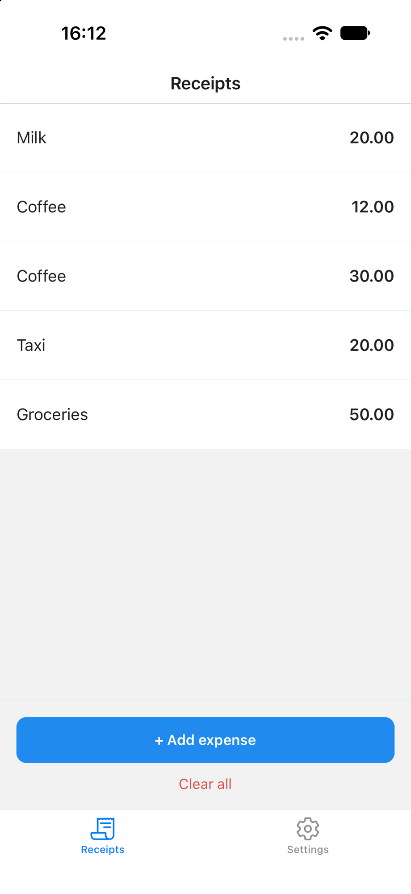
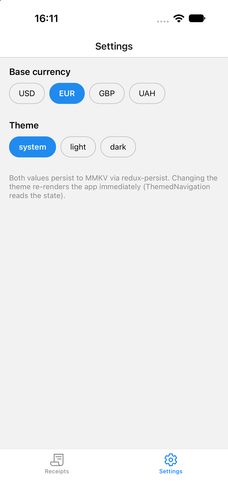
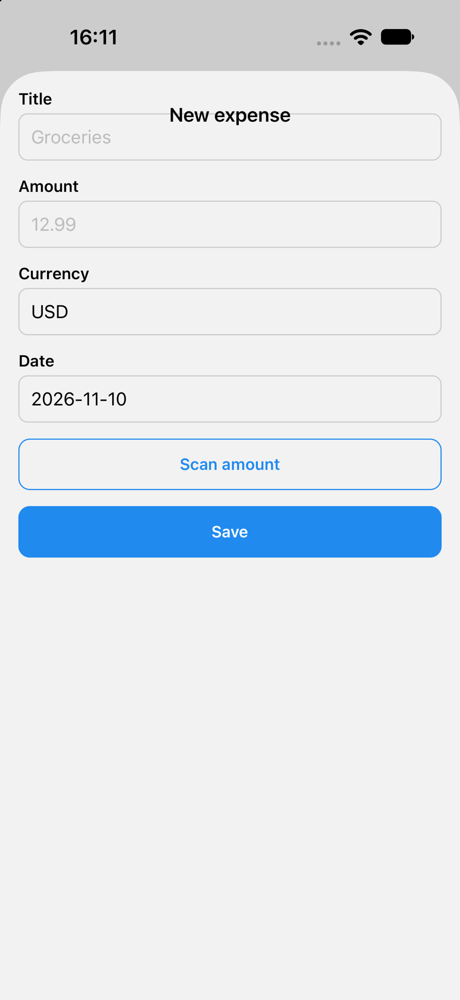

# RN_Sample

A small expense tracker I built to keep one clean example of every React Native topic that shows up in interviews: navigation, a local database, server state, forms, lists, gestures, images, and a native module. No product noise, just the patterns. It also got me back into the New Architecture after years on the old bridge.

The app is called Receipts. It stores expenses in SQLite, converts each one to your base currency using historical rates from the Frankfurter API, and lets you attach a receipt photo. On iOS it reads the total off that photo with an on-device OCR module written in Swift.



## What's in it

- **Navigation.** Expo Router, file-based: a tab layout, a modal for the add-expense form, and a `receipts://expense/<id>` deep link.
- **Database.** expo-sqlite behind a repository, with versioned migrations and keyset pagination.
- **Server state.** React Query against the Frankfurter currency API. Historical rates get `staleTime: Infinity`, since they never change once published.
- **Client state.** Redux Toolkit for settings (base currency, theme), persisted to MMKV so they survive a relaunch.
- **Forms.** React Hook Form with zod validation.
- **Lists and gestures.** FlashList with day section headers and swipe-to-delete built on Reanimated.
- **Native module.** A local Swift module, `receipt-ocr`, runs Apple Vision text recognition on a file and hands back the lines; a pure `parseTotal` function picks out the total (tested with Jest). Android gets a no-op fallback.

## Screens

 

Settings (Redux + MMKV) and the add-expense form (React Hook Form + zod, with the iOS-only Scan amount button that runs the native OCR module).

## Stack

Expo SDK 58, React Native 0.88, React 19.3, New Architecture (Fabric, TurboModules, JSI, Hermes), TypeScript in strict mode. Every dependency went in through `expo install` so the versions match the SDK.

## Running it

Needs Node 22 and Xcode 26.2. It ships a native module and MMKV, so it runs as a dev build, not in Expo Go.

```bash
nvm use                                      # Node 22
npm install
npx expo prebuild -p ios                     # generates ios/, installs 121 pods
npx expo run:ios --device "iPhone 18 Pro"    # iOS 27.2
```

One trap: the build links against Xcode 26.2's libc++, so the same binary crashes at launch on an older simulator (iOS 17.4) that lacks those symbols. Run it on an iOS 26 or 27 simulator. `npx tsc --noEmit` is clean and `npx jest` passes the `parseTotal` suite.
